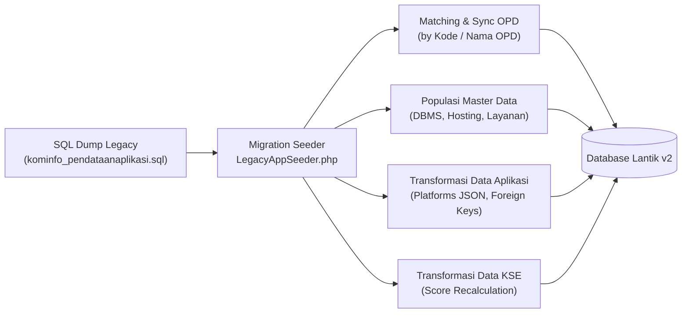

# Implementation Plan: Modul Pendataan Aplikasi & Kategorisasi Sistem Elektronik (KSE)

Dokumen ini merupakan rencana kerja teknis (implementation plan) komprehensif untuk mengintegrasikan dan memodernisasi modul **Pendataan Aplikasi (SIPA)** serta **Kategorisasi Sistem Elektronik (KSE)** dari sumber data legacy (`docs/kominfo_pendataanaplikasi.sql`) ke dalam ekosistem **Lantik v2** berbasis Laravel 12 & Filament v4.

---

## 1. Ringkasan Eksekutif & Tujuan

### 1.1 Latar Belakang
Pada sistem terdahulu, pendataan aplikasi dan kategorisasi sistem elektronik dikelola melalui aplikasi terpisah (SIPA Tanjungpinang). Melalui migrasi ini, seluruh pendataan aset digital, spesifikasi teknis, integrasi sistem, penanggung jawab (PIC), serta pemenuhan kepatuhan KSE (berdasarkan standar BSSN/Kominfo) akan disatukan ke dalam satu dashboard terpadu di **Lantik v2**.

### 1.2 Tujuan Utama
1. **Unifikasi Data**: Menggabungkan data master aplikasi, kategorisasi SE, dan master referensi ke skema database modern Lantik v2.
2. **Standardisasi Skema**: Mengonversi struktur tabel legacy menjadi Eloquent Model Laravel 12 dengan tipe data strongly-typed, timestamps, soft-deletes, dan relasi foreign key yang terstandar.
3. **Manajemen Berbasis Peran (RBAC)**: Memanfaatkan Spatie Permission & Filament Shield agar Admin OPD hanya dapat mengelola data milik OPD-nya, sementara Diskominfo bertindak sebagai verifikator/approver.
4. **Automasi Penilaian KSE**: Menghitung skor indeks KSE (`nilai_kse`) dan menentukan predikat secara otomatis (`STRATEGIS`, `TINGGI`, `RENDAH`) berdasarkan algoritma pembobotan.
5. **Reporting & Ekspor**: Menyediakan rekapitulasi data dalam format Excel dan cetak PDF form/berita acara inventarisasi aset digital.

---

## 2. Analisis Struktur Data Legacy (`kominfo_pendataanaplikasi.sql`)

### 2.1 Entitas & Tabel Sumber
| Tabel Legacy | Deskripsi | Rencana Migrasi ke Lantik v2 |
|---|---|---|
| `data_aplikasi` | Data inventaris aplikasi, teknologi, PIC, hosting, dan status | Model `App\Models\Application` / `data_aplikasi` |
| `kategorisasi_se` | Penilaian mandiri kepatuhan SE (10 indikator risiko & skor) | Model `App\Models\ElectronicSystemCategorization` |
| `master_opd` | Data dinas / badan / instansi pemerintah | Sinkronisasi/mapping dengan tabel `opd` yang sudah ada di Lantik v2 |
| `master_jenis_layanan` | Klasifikasi layanan (Publik, Internal OPD, Antar OPD, dll.) | Model `App\Models\ApplicationServiceType` |
| `master_dbms` | Referensi database (MySQL, PostgreSQL, Oracle, SQLite, dll.) | Model `App\Models\DatabaseManagementSystem` |
| `master_lokasi_hosting` | Lokasi penempatan server (Data Center Kominfo, Cloud, dll.) | Model `App\Models\HostingLocation` |
| `master_frekuensi_penggunaan`| Intensitas penggunaan (Harian, Mingguan, Bulanan, dll.) | Model `App\Models\UsageFrequency` |

---

## 3. Desain Skema Database Modern (Laravel Migrations)

### 3.1 Master Data Migrations

#### A. `application_service_types`
- `id` (bigIncrements)
- `name` (string) - contoh: *Pelayanan Publik*, *Administrasi Pemerintahan*
- `description` (text, nullable)
- `is_active` (boolean, default true)
- `timestamps()`

#### B. `database_systems` (DBMS)
- `id` (bigIncrements)
- `name` (string) - contoh: *MySQL/MariaDB*, *PostgreSQL*, *Oracle DB*
- `is_active` (boolean, default true)
- `timestamps()`

#### C. `hosting_locations`
- `id` (bigIncrements)
- `name` (string) - contoh: *Data Center Diskominfo*, *Cloud / VPS*, *Server Sendiri*
- `is_active` (boolean, default true)
- `timestamps()`

#### D. `usage_frequencies`
- `id` (bigIncrements)
- `name` (string) - contoh: *Harian*, *Mingguan*, *Bulanan*, *Tahunan*
- `is_active` (boolean, default true)
- `timestamps()`

---

### 3.2 Tabel Utama: `applications` (`data_aplikasi`)

```php
Schema::create('applications', function (Blueprint $table) {
    $table->id();
    $table->foreignId('opd_id')->constrained('opd')->cascadeOnDelete();
    
    // Identitas Dasar
    $table->enum('source_type', ['internal_dev', 'third_party'])->default('internal_dev'); // asal_aplikasi (1=Sendiri, 2=Pihak Ketiga)
    $table->string('name');
    $table->string('vendor_name')->nullable(); // penyedia_aplikasi
    $table->text('description')->nullable();
    $table->year('launch_year')->nullable();
    
    // Spesifikasi Teknis & Infrastruktur
    $table->json('platforms')->nullable(); // basis_aplikasi: web, android, ios, desktop
    $table->string('programming_languages')->nullable(); // bahasa_pemrograman
    $table->foreignId('database_system_id')->nullable()->constrained('database_systems')->nullOnDelete();
    $table->string('other_database')->nullable();
    $table->foreignId('hosting_location_id')->nullable()->constrained('hosting_locations')->nullOnDelete();
    $table->string('domain_url')->nullable();
    
    // Klasifikasi Layanan & Penggunaan
    $table->foreignId('service_type_id')->nullable()->constrained('application_service_types')->nullOnDelete();
    $table->foreignId('usage_frequency_id')->nullable()->constrained('usage_frequencies')->nullOnDelete();
    $table->string('user_count_range')->nullable(); // jumlah_pengguna
    
    // Integrasi Antar Sistem
    $table->enum('integration_status', ['ada', 'tidak_ada', 'tidak_tahu'])->default('tidak_ada');
    $table->string('integration_method')->nullable(); // REST API, Webhook, Database Link
    $table->text('integrated_applications')->nullable();
    $table->text('integrated_opds')->nullable();
    
    // Tata Kelola, Legalitas, & Tim PIC
    $table->text('legal_basis')->nullable(); // regulasi / dasar hukum pembentukan aplikasi
    $table->string('pic_name');
    $table->string('pic_nip', 30)->nullable();
    $table->string('pic_position')->nullable();
    $table->string('pic_phone', 25)->nullable();
    
    // Berkas & Dokumen Terkait
    $table->string('spt_file_path')->nullable(); // disimpan pada disk 'local' (storage/app/private)
    $table->string('logo_file_path')->nullable(); // disimpan pada disk 'public' (storage/app/public)
    $table->string('business_process_name')->nullable(); // proses_bisnis (nama proses bisnis)
    $table->string('business_process_file_path')->nullable(); // disimpan pada disk 'local' (storage/app/private)
    $table->text('user_privileges_note')->nullable(); // level_privileges
    $table->text('future_plan')->nullable(); // rencana_aplikasi
    $table->string('asset_registration_number')->nullable(); // nomor_registrasi_aset
    
    // Approval & Workflow State
    $table->enum('verification_status', ['draft', 'submitted', 'verified', 'rejected'])->default('draft');
    $table->text('verification_notes')->nullable();
    $table->boolean('is_active')->default(true);
    
    // Audit Trail
    $table->foreignId('created_by')->nullable()->constrained('users')->nullOnDelete();
    $table->foreignId('updated_by')->nullable()->constrained('users')->nullOnDelete();
    $table->foreignId('verified_by')->nullable()->constrained('users')->nullOnDelete();
    $table->timestamp('verified_at')->nullable();
    
    $table->softDeletes();
    $table->timestamps();
});
```

---

### 3.3 Tabel Kategorisasi: `electronic_system_categorizations` (`kategorisasi_se`)

Tabel ini menyimpan instrumen penilaian mandiri Sistem Elektronik berdasarkan standar BSSN/Kominfo:

```php
Schema::create('electronic_system_categorizations', function (Blueprint $table) {
    $table->id();
    $table->foreignId('application_id')->constrained('applications')->cascadeOnDelete();
    $table->foreignId('opd_id')->constrained('opd')->cascadeOnDelete();
    $table->year('assessment_year');
    
    // 10 Indikator Penilaian Skor (Nilai 1 - 5)
    $table->unsignedTinyInteger('score_investment_value')->default(1);
    $table->unsignedTinyInteger('score_operational_budget')->default(1);
    $table->unsignedTinyInteger('score_legal_compliance')->default(1);
    $table->unsignedTinyInteger('score_cryptography_usage')->default(1);
    $table->unsignedTinyInteger('score_user_base')->default(1);
    $table->unsignedTinyInteger('score_personal_data_processing')->default(1);
    $table->unsignedTinyInteger('score_data_confidentiality')->default(1);
    $table->unsignedTinyInteger('score_business_process_criticality')->default(1);
    $table->unsignedTinyInteger('score_failure_impact')->default(1);
    $table->unsignedTinyInteger('score_potential_loss')->default(1);
    
    // Kalkulasi Skor Total & Kategori Predikat
    $table->unsignedInteger('total_score')->default(10); // nilai_kse
    $table->enum('category', ['STRATEGIS', 'TINGGI', 'RENDAH'])->default('RENDAH');
    
    $table->text('notes')->nullable();
    $table->enum('verification_status', ['draft', 'submitted', 'verified', 'rejected'])->default('draft');
    $table->text('verification_notes')->nullable();
    $table->boolean('is_active')->default(true);
    
    $table->foreignId('assessed_by')->nullable()->constrained('users')->nullOnDelete();
    $table->foreignId('verified_by')->nullable()->constrained('users')->nullOnDelete();
    $table->timestamp('verified_at')->nullable();
    
    $table->softDeletes();
    $table->timestamps();
});
```

#### Rumus & Ambang Batas Skor Kategorisasi SE:
- **Total Skor (`total_score`)** = Penjumlahan dari ke-10 parameter indikator.
- **Predikat Kategori**:
  - `STRATEGIS`: Total Skor $\ge 35$ (atau bobot kritikal tertinggi pada pemrosesan data rahasia negara / layanan vital publik).
  - `TINGGI`: Total Skor antara $20 - 34$.
  - `RENDAH`: Total Skor $\le 19$.

---

## 4. Rencana Migrasi Data (ETL Script & Seeder)

Untuk memindahkan data dari file `docs/kominfo_pendataanaplikasi.sql` ke database Lantik v2:



### Langkah Eksekusi Migrasi Data:
1. **Penyelarasan Master OPD**:
   - Skrip melakukan pencocokan antara `master_opd.id_opd` atau `master_opd.nama` dengan tabel `opd` di Lantik v2.
   - Buat mapping array relasional: `$legacyOpdMap[$legacyId] = $modernOpdId`.
2. **Import Master Data**:
   - Jalankan seeder untuk tabel `database_systems`, `hosting_locations`, `application_service_types`, dan `usage_frequencies`.
3. **Konversi Format Basis Aplikasi**:
   - Kolom lama `basis_aplikasi` berupa string koma (contoh: `"Website, Android,"`) dikonversi menjadi format array JSON native: `["web", "android"]`.
4. **Validasi File Lampiran (SPT, Logo, Probis)**:
   - File **Logo** (`logo_file_path`) diarahkan ke disk `public` (`storage/app/public/applications/logos/...`).
   - File **SPT** (`spt_file_path`) dan **Proses Bisnis / Probis** (`business_process_file_path`) disimpan pada disk `local` (`storage/app/private/applications/spt/...` dan `storage/app/private/applications/probis/...`) dan diakses melalui `ApplicationFileController` yang memvalidasi autentikasi & otorisasi pengguna.

---

## 5. Implementasi Filament v4 UI & Resources

Sesuai dengan konvensi Filament v4 yang digunakan pada Lantik v2 (seperti pada modul `ServerResource`), resource akan dibagi ke dalam arsitektur terstruktur:

### 5.1 Struktur Direktori Modul Baru
```
app/
├── Filament/
│   └── Resources/
│       ├── Applications/
│       │   ├── ApplicationResource.php
│       │   ├── Pages/
│       │   │   ├── ListApplications.php
│       │   │   ├── CreateApplication.php
│       │   │   ├── EditApplication.php
│       │   │   └── ViewApplication.php
│       │   ├── Schemas/
│       │   │   ├── ApplicationForm.php
│       │   │   └── ApplicationInfolist.php
│       │   └── Tables/
│       │       └── ApplicationsTable.php
│       ├── ElectronicSystemCategorizations/
│       │   ├── ElectronicSystemCategorizationResource.php
│       │   ├── Pages/
│       │   │   ├── ListElectronicSystemCategorizations.php
│       │   │   ├── CreateElectronicSystemCategorization.php
│       │   │   └── EditElectronicSystemCategorization.php
│       │   ├── Schemas/
│       │   │   └── CategorizationForm.php
│       │   └── Tables/
│       │       └── CategorizationsTable.php
│       └── MasterData/ (Kelompok Master SIPA)
│           ├── ApplicationServiceTypeResource.php
│           ├── DatabaseSystemResource.php
│           ├── HostingLocationResource.php
│           └── UsageFrequencyResource.php
```

### 5.2 Fitur Form & Wizard pada `ApplicationResource`
- Menggunakan **Filament Wizard / Tabbed Layout**:
  - **Tab 1: Identitas & Kepemilikan**: Nama Aplikasi, OPD Pengampu, Asal (Buatan Sendiri / Pihak Ke-3), Vendor Pengembang, Tahun Rilis, Deskripsi.
  - **Tab 2: Arsitektur & Infrastruktur**: Multi-select Platform (Web, Android, iOS, Desktop), Bahasa Pemrograman, Pilihan DBMS & Hosting, Domain / URL Aplikasi.
  - **Tab 3: Layanan & Integrasi**: Jenis Layanan SPBE, Frekuensi Penggunaan, Estimasi Jumlah Pengguna, Status Integrasi (Ada/Tidak), Metode Integrasi & Aplikasi Terkait.
  - **Tab 4: Penanggung Jawab & Dokumen**: Nama PIC, NIP, Jabatan, Nomor Telepon / WA, Upload SPT, Upload Logo, Upload Dokumen Probis.
  - **Tab 5: Verifikasi (Khusus Role Admin Kominfo)**: Status Verifikasi, Catatan Koreksi, Tanggal Approval.

### 5.3 Fitur Otomatisasi Form `CategorizationForm`
- **Reactive Scoring**: Form memuat 10 slider atau radio group pertanyaan indikator (skala 1-5).
- Input langsung mengkalkulasi `$set('total_score', ...)` dan `$set('category', ...)` secara real-time di antarmuka sebelum disimpan.

---

## 6. Hak Akses & Kebijakan Keamanan (RBAC / Filament Shield)

Konfigurasi seeder izin Spatie (`ApplicationPermissionSeeder.php`):
- **Entitas Baru**:
  - `application`
  - `electronic_system_categorization`
  - `application_master_data`

### Aturan Multi-Tenancy Berdasarkan OPD:
1. **Super Admin & Admin Diskominfo**:
   - Dapat melihat seluruh aplikasi dari semua OPD.
   - Berhak mengubah `verification_status` (verifikasi / tolak / minta perbaikan).
   - Akses penuh kelola master data referensi.
2. **Operator / Admin OPD**:
   - Query dibatasi otomatis pada `getEloquentQuery()`:
     ```php
     public static function getEloquentQuery(): Builder
     {
         $user = auth()->user();
         if ($user->hasRole(['super_admin', 'admin_kominfo'])) {
             return parent::getEloquentQuery();
         }
         return parent::getEloquentQuery()->where('opd_id', $user->opd_id);
     }
     ```
   - Hanya dapat mendaftarkan aplikasi baru atau merevisi status jika berstatus `draft` atau `rejected`.

---

## 7. Ekspor, Pelaporan & Integrasi Dashboard

1. **Ekspor Data Aplikasi (Excel)**:
   - Tombol ekspor di tabel Filament menggunakan paket `pxlrbt/filament-excel`.
   - Menghasilkan rekap data lengkap sesuai format standar pendataan aplikasi SPBE nasional.
2. **Cetak Lembar Verifikasi & Profil Aplikasi (PDF)**:
   - Action khusus `Download Profile PDF` per baris aplikasi menggunakan `barryvdh/laravel-dompdf`.
   - Berisi resume spesifikasi aplikasi, kontak PIC, dan tanda tangan berita acara pendataan.
3. **Dashboard Widgets**:
   - **Statistik Total Aplikasi**: Total Terdata, Beroperasi Aktif, Dalam Pengembangan.
   - **Distribusi Hosting**: Chart proporsi aplikasi di Data Center Kominfo vs Server Eksternal.
   - **Distribusi KSE**: Pie chart sebaran status *Strategis*, *Tinggi*, dan *Rendah*.

---

## 8. Jadwal & Tahapan Pelaksanaan (Milestones)

| Fase | Durasi | Rincian Pekerjaan | Output |
|---|---|---|---|
| **Fase 1: Database & Model** | Hari 1 - 2 | - Migrasi tabel master & tabel utama (`applications`, `categorizations`)<br>- Model Eloquent, Relasi, Mutator & Casts | Migration files & Eloquent Models |
| **Fase 2: Script Seeder & Migrasi Data** | Hari 3 | - Script ETL parser `kominfo_pendataanaplikasi.sql`<br>- Mapping OPD & import data eksisting | Database terisi data riil legacy |
| **Fase 3: Filament v4 Resources** | Hari 4 - 6 | - Pembangunan Form, Table, Infolist untuk Aplikasi & KSE<br>- Form Wizard, kalkulasi otomatis nilai KSE | Modul UI di panel Filament |
| **Fase 4: Role & Shield Permissions** | Hari 7 | - Konfigurasi hak akses Spatie/Shield<br>- Scoping query berdasarkan OPD pengguna | Keamanan data antar OPD aktif |
| **Fase 5: Reporting & Ekspor** | Hari 8 | - Template cetak PDF lembar profil aplikasi<br>- Export Excel inventarisasi aset digital | Fitur ekspor siap pakai |
| **Fase 6: Testing & Review** | Hari 9 | - Uji fungsi CRUD, validasi relasi data, & verifikasi workflow<br>- Penyesuaian antarmuka pengguna | Modul siap rilis produksi |

---

## 9. Rekomendasi Langkah Selanjutnya

1. **Review & Konfirmasi**: Verifikasi apakah penamaan tabel (`applications` vs `data_aplikasi`) ingin menggunakan konvensi bahasa Inggris (standar Laravel) atau tetap bahasa Indonesia.
2. **Eksekusi Fase 1**: Membuat migration schema dan model Eloquent yang dibutuhkan.
3. **Eksekusi Fase 2**: Menjalankan seeder migrasi dari `docs/kominfo_pendataanaplikasi.sql`.

